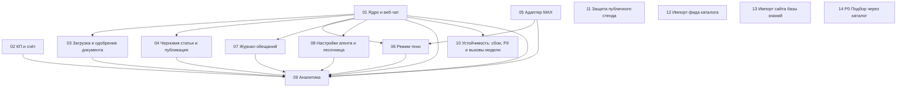

 # ИИ-агент поддержки — карта тикетов

 ## Состояние

 - Спецификация: `.specs/support-agent.md`; локальная копия: `.scratch/support-agent/spec.md`, побайтово идентичная спецификации.
 - Трекер: локальные файлы Markdown в `.scratch/support-agent/`.
 - Решения: `GLOSSARY.md`, `adr/0001`–`adr/0016`.
 - Контракт и модель данных заморожены до старта волны 1: `.scratch/support-agent/issues/12-import-catalog-feed.md` и `.scratch/support-agent/issues/13-import-knowledge-site.md` используют их как входные артефакты, а не как блокирующий тикет.
 - Начальный фронтир волны 1: тикеты 01, 02, 05, 11, 12, 13. Все шесть готовы к отдельным планам; тяжёлые импортные прогоны 12 и 13 не выполняются одновременно.
 - Волна 2 начинается после слияния 01: тикеты 03, 04, 06, 07, 08, 09, 10.
 - Перечень тикетов и их статусы не являются разрешением на реализацию: для каждого тикета/волны нужны план, Г3a и отдельное «поехали» владельца.

 ## Покрытие требований тикетами

 | Требование | Тикет | Свидетельство приёмки |
 |---|---|---|
 | R1a подбор, когда клиент знает продукт | 01, 12, 14 | Уточнения по версии/количеству/сроку/типу развёртывания и ссылка на вариант |
 | R1b подбор, когда клиент не знает продукт | 01, 12, 13, 14 | Вопросы о задаче/бюджете/инфраструктуре; 2–3 варианта с обоснованием и источниками |
 | R2 КП по корпоративному бланку Softline | 02 | КП на проверку менеджеру: подтверждённые поля, вычисленные суммы и оформление R26 |
 | R3 счёт по корпоративному бланку | 02 | Счёт только по отдельному запросу, реквизиты вставляет код, брендовый бланк по R26 |
 | R4 эскалация | 01, 05 | Очередь содержит причину, резюме, трассу и черновик |
 | R5 трасса и экономика | 01, 09 | Упорядоченная трасса; стоимость вычисляется по фактическим данным |
 | R6 загрузка документа командой | 03 | Документ недоступен поиску до одобрения менеджером |
 | R7 статья из диалога | 04 | Черновик недоступен до одобрения и публикации |
 | R8 веб-чат | 01 | Подписанная cookie диалога; ответ/эскалация в Web; оформление по R26 |
 | R9 канал MAX | 05 | Живой polling-вход достигает ядра; отправка только при `respond` |
 | R10 режим тени | 06 | Оба канала не отправляют клиенту; менеджер видит черновик/эскалацию |
 | R12 настройки, песочница и аудит | 08 | Изолированная проверка, аудит без секретов; кабинет в стиле R26 |
 | R11 журнал обещаний | 07 | Канал/адресат/срок/статус; MAX без email, Web только после email; просрочка в кабинете |
 | R14 маскирование данных | 01, 10 | В модель идут только метки; сырые значения блокируются на выходе |
 | R15 единая установка на одного клиента | 10 | Один клиент на установку; служебный `tenant_id` не влияет на демо |
 | R16 тайм-ауты и повтор модели | 10 | Ограниченные вызовы; тайм-аут/исчерпание повтора эскалируется |
 | R17 защита публичного стенда | 11 | Код доступа, лимиты и бюджет на сервере; экран доступа оформлен по R26 |
 | R18 импорт БЗ заказчика | 13 | Обход по правилам, чанки с URL, провенанс и статус `approved_by_customer` |
 | R19 импорт фида и структурный каталог | 12 | Потоковый импорт, подтверждённое число предложений, точные фильтры без вектора |
 | R20 таксономия намерений | 01, 09 | 10 routing-классов ADR-0017 + 9 аналитических категорий миграции 170; маппинг и дорожка в трассе |
 | R21 экономика для 500 обращений в день | 09 | Проекция отделена от фактически измеренных демо-данных |
 | R22 происхождение каталога и знаний | 12, 13 | Ответ/трасса содержат URL, дату и идентификатор снимка |
 | R23 суточное обновление фида | 12 | Ручной запуск, хеш/дата снимка, работа с последним снимком без cron |
 | R24 срок электронной поставки | 02 | Допущение явно помечено и не отправляется без проверки менеджером |
 | R25 двухволновая реализация | 01–13 | Граф ацикличен, первая волна имеет шесть начальных тикетов |
 | R26 фирменный стиль Softline | 01, 02, 05, 08, 11 | UI и документы проверяются на палитру, шрифты, логотип/охранное поле, бланк, страницу доступа, аватар MAX и презентационный титул |

 ## Граф зависимостей
 

Тикеты 01, 02, 05, 11, 12, 13 остаются независимыми по решению владельца и exec; для 02/05/11/12/13 входом служат замороженные контракт и модель данных. Тикет 14 (P0) блокируется только замороженными контрактом и моделью данных; supervisor включает его во фронтир после получения плана от exec. Волна 2 включает 03, 04, 06, 07, 08, 09 и тикет 10 по устойчивости; мультитенантная изоляция не входит в граф. Объявление статуса или фронтира не заменяет отдельный план, Г3a и разрешение владельца на исполнение.

## Расчёт границы

- Начальный фронтир волны 1 остаётся 01, 02, 05, 11, 12, 13; тикет 14 добавляется supervisor отдельно после плана exec.
- Тикеты 03, 04, 06, 07, 08, 09, 10 по зависимости от 01 и 05 разблокируются после указанных в графе входов; тикет 10 охватывает только сбои модели/среды выполнения и PII, без арендаторов.
- Каждый срез требует собственной проверки Г3b; планы первой волны подаются пакетом на Г3a, «поехали» владельца выдаётся на волну.

## Как обновлять

Для каждого завершённого тикета записывать краткую ссылку на контекст и свидетельства. Полные требования и критерии приёмки находятся в `.specs/support-agent.md`; планы не меняют их самостоятельно.

- ADR-0001 — один процесс и семь узлов ядра.
- ADR-0002 — Web и MAX используют общее ядро; для спринта используется Long Polling.
- ADR-0003 — PostgreSQL 16 и `tenant_id` с первого дня.
- ADR-0004 — маскировать персональные данные до LLM и проверять исходящий ответ.
- ADR-0005 — документы и черновики статей одобряются раздельно до поиска; материалы заказчика имеют отдельный провенанс.
- ADR-0006 — система Ивы используется только как источник идей и образцов интерфейса.
- ADR-0007 — Node/TypeScript, модель через OpenCode Go и ограниченный повтор.
- ADR-0008 — режим тени не отправляет клиенту ответы.
- ADR-0009 — публичный стенд требует единого кода доступа и жёстких лимитов.
- ADR-0010 — каталог ищется структурно, векторный поиск применяется к БЗ.
- ADR-0011 — локальная разработка, отдельная серверная БД для демонстрации.
- ADR-0012 — брендбук Softline задаёт UI/печать, шрифты, логотип и ограничения.
- ADR-0013 — MAX API host и маршруты OpenCode Go для chat/embeddings, параметры моделей и эскалация отказов.
- ADR-0014 — формат клиентского ответа, small talk и режимы эскалации.
- ADR-0015 — два сценария подбора и P0-расхождение ядра с принятыми требованиями.
- ADR-0016 — однотенантное развёртывание; `tenant_id` — служебное зарезервированное поле.
- ADR-0017 — 10 классов маршрутизации, 9 аналитических категорий и URL-free клиентский текст.
- ADR-0018 — обещания и доставка документов: MAX и email.
